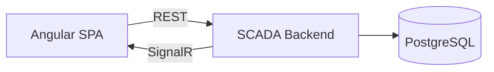

# SCADA Frontend

The Angular client of a **SCADA (Supervisory Control and Data Acquisition)** system, developed as a team project for the **Software for Supervisory Control Systems** course.

It provides an interface for managing tags and alarms, monitoring values in real time and generating reports. The client communicates with the backend using REST and receives live updates using SignalR.

## Features

* User registration and login
* Creating and deleting analog and digital, input and output tags
* Turning scanning of input tags on and off
* Changing the values of output tags
* Real-time trending table of tag values
* Creating and removing alarms with a threshold, a type and a priority
* Live notifications for triggered alarms
* Database view of all tags
* Reports:
  * Alarms in a time period
  * Alarms by priority
  * Tags in a time period
  * Last values of analog and digital inputs
  * Tag history by tag ID

## Architecture



The client connects to two SignalR hubs on the backend:

* `/tagChangeHub` – tag value changes
* `/alarmAlertedHub` – triggered alarms

## Technologies

* Angular 16
* Angular Material
* TypeScript
* RxJS
* SignalR (`@microsoft/signalr`)

## Repository Structure

```text
frontent/
└── scada-frontend/
    └── src/
        ├── app/
        │   ├── auth/
        │   ├── components/
        │   ├── models/
        │   ├── pages/
        │   └── services/
        └── environments/
```

* `auth` – authentication service and route guard
* `components` – reusable UI components such as the tag and alarm forms, tables and report views
* `models` – TypeScript models for tags, alarms and users
* `pages` – routed pages
* `services` – communication with the backend and SignalR connections

## Getting Started

### Prerequisites

Install:

* [Node.js](https://nodejs.org/) 16 or 18
* Angular CLI

```bash
npm install -g @angular/cli@16
```

The [SCADA backend](https://github.com/ScadaSystemTeam11/scada) must be running at:

```text
http://localhost:5022
```

### Run the Frontend

Navigate to the Angular application:

```bash
cd scada-frontend
```

Install dependencies:

```bash
npm install
```

Start the application:

```bash
ng serve
```

The application will be available at:

```text
http://localhost:4200
```

### Configuration

The REST API URL is defined in:

```text
src/environments/environment.ts
```

The SignalR hub URLs are defined in:

```text
src/app/services/tag.service.ts
src/app/services/alarm.service.ts
```

Update them if the backend runs on a different address.

### Login

After the backend has been seeded, you can log in with the default administrator account:

```text
username: veljkob
password: veljko123
```

You can also register a new user on the login page.

## Backend

The backend is located in a separate repository:

https://github.com/ScadaSystemTeam11/scada
